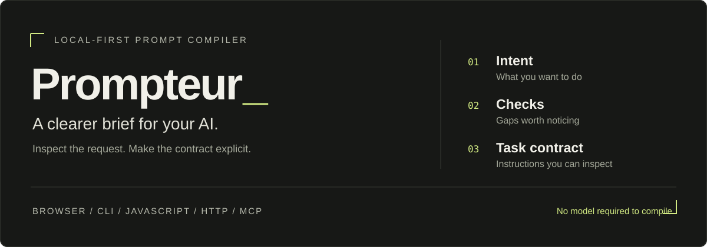

# Prompteur

**Check your AI request. Turn it into an explicit task brief.**

Prompteur is a local-first prompt compiler and linter. It checks a request for common gaps, then organizes it into instructions covering the objective, constraints, output, and verification. You can inspect the result or call the same compiler from an agent or script.

[](https://nodejs.org/)
[](LICENSE)

**[Open the demo](https://santandon.github.io/prompteur/)** · [Quick start](#quick-start) · [Agent integration](#use-it-from-your-tools) · [OpenCode plans](#opencode-plugin-proposed) · [Documentation](#documentation)

---

## What does it actually do?

| Step | What happens | What you get |
| :--- | :--- | :--- |
| **Check** | Rules look for vague objectives, missing output requirements, and other defined issues. | Findings and suggested changes. |
| **Compile** | The compiler organizes your request for a general, coding-agent, research, or image target. | A structured prompt called a **task contract**. |
| **Inspect** | The same result includes diagnostics, provenance, and a structured representation called **Prompt IR**. | An explanation of what the compiler produced. |

For example, give it:

> Review the login flow. Do not change the public API. Return a Markdown checklist.

With the **agent** target and **markdown** output format, the compiled result includes:

```text
## Hard constraints
- Do not change the public API.

## Execution method
- Inspect the available context and tools before changing anything.
- Use the smallest coherent implementation that satisfies the objective.
- Do not invent file contents, commands, test results, or completed work.
- Verify the changed behavior and report remaining risk.
```

*An excerpt from the deterministic output. Prompteur writes instructions; it does not perform that review or run those checks.*

### When is it useful?

- **Before handing off a task:** notice missing context or an unspecified deliverable.
- **Inside tools:** obtain one consistent, machine-readable result through CLI, JavaScript, HTTP, or MCP.
- **When testing prompt changes:** compare raw requests and compiled variants using the evaluation tooling.

**A longer prompt is not proof of a better result.** Readiness scores are rule-based signals, not accuracy predictions. Whether compilation helps your model on your tasks still needs evaluation; a clear original request may already be enough.

## Quick start

### Explore without installing anything

Open the **[browser demo](https://santandon.github.io/prompteur/)**, enter a request, choose a target, and select **Compile intent**. Inspect the contract, findings, and Prompt IR. Compilation runs in your browser; the demo does not provide the local provider proxy.

### Compile from your terminal

Requires **[Node.js 22+](https://nodejs.org/)** and Git. No dependency installation or API key is needed.

```bash
git clone https://github.com/SantanDon/prompteur.git
cd prompteur
node bin/prompteur.js --target agent --output-format markdown "Review the login flow. Do not change the public API. Return a Markdown checklist."
```

The contract prints in your terminal. To inspect a vague request instead:

```bash
node bin/prompteur.js analyze "Fix this"
```

### Start the local bridge

From the cloned repository:

```bash
npm start
```

The server listens at **http://127.0.0.1:3030**. It hosts the workbench, local HTTP API, and optional provider proxy. Stop it with **Ctrl+C**.

> [!NOTE]
> The `0.3.1` local workbench has a known startup issue: its static allowlist omits `src/core/profiles.js`. Use the hosted demo or CLI while that fix is pending. The deterministic HTTP API is separate from this browser-loading issue. Opening `index.html` directly is not supported.

## Use it from your tools

One shared `compileRequest` pipeline backs every deterministic interface.

| Interface | Entry point | Best for |
| :--- | :--- | :--- |
| Browser | [Hosted workbench](https://santandon.github.io/prompteur/) | Exploring contracts and diagnostics |
| CLI | `node bin/prompteur.js` | Text, files, stdin, and shell pipelines |
| JavaScript | `src/core/pipeline.js` | Embedding compilation in another tool |
| HTTP | `POST /api/compile` | Local processes using a JSON API |
| MCP | `node bin/prompteur-mcp.js` | Letting an agent call compiler tools directly |

<details>
<summary><strong>CLI: files, stdin, JSON, and a reusable command</strong></summary>

```bash
node bin/prompteur.js --file user_task.md --target agent > compiled-task.md
echo "Compare local AI evaluation tools" | node bin/prompteur.js --target research
node bin/prompteur.js --target research --json "Compare prompt evaluation methods."
node bin/prompteur.js capabilities
node bin/prompteur.js --help
```

Optionally run `npm link` from the repository to make `prompteur` and `prompteur-mcp` available as local commands.

</details>

<details>
<summary><strong>MCP: three read-only tools for your agent</strong></summary>

Configure your MCP client to launch `node` with the absolute path to `bin/prompteur-mcp.js`. The client starts the stdio process; no HTTP server or browser is needed.

| Tool | Result |
| :--- | :--- |
| `compile_intent` | Compiled contract, Prompt IR, diagnostics, and provenance |
| `analyze_intent` | Analysis without the rendered contract |
| `get_compiler_capabilities` | Supported options, targets, and limits |

The MCP server has no file access, command execution, provider calls, network access, or prompt persistence. Configuration syntax depends on the client. See the [MCP guide](docs/MCP.md).

</details>

<details>
<summary><strong>JavaScript: call the compiler directly</strong></summary>

From a JavaScript module in the cloned repository:

```js
import { compileRequest } from './src/core/pipeline.js';

const result = compileRequest('Review the login flow. Do not change the public API.', {
  target: 'agent',
  outputFormat: 'markdown',
});

console.log(result.prompt);
console.log(result.analysis);
```

The package also exports this pipeline as `prompteur` when used as a package dependency.

</details>

<details>
<summary><strong>HTTP: use the loopback JSON API</strong></summary>

With `npm start` running, call it from another terminal. Bash example:

```bash
curl -s http://127.0.0.1:3030/api/compile \
  -H "Content-Type: application/json" \
  -d '{"input":"Review the login flow. Do not change the public API.","options":{"target":"agent","outputFormat":"markdown"}}'
```

Discover supported options with `GET /api/capabilities`. The [OpenAPI document](openapi.json) is also served at `/openapi.json`. The API accepts loopback clients and does not send permissive CORS headers. See [Integrations](docs/INTEGRATIONS.md).

</details>

## OpenCode plugin: proposed

**An inline OpenCode plugin is not implemented yet.** MCP integration exists today, but it does not automatically check or rewrite every message you send.

The proposed plugin would check requests where you already type, preserve your original message by default, and compile a replacement only when explicitly requested.

| Proposed command | Intended behavior |
| :--- | :--- |
| `/prompteur on` | Enable checks for the current chat |
| `/prompteur off` | Bypass checks for subsequent messages |
| `/prompteur status` | Show whether checks are enabled |
| `/prompteur improve …` | Compile one request explicitly |

These commands are a design proposal, **not available commands**. The intended default is off. Any automatic rewriting would need evidence that it helps real tasks before becoming a default.

## Optional model candidates

Deterministic compilation needs no model. Optional rewrites use **Ollama on localhost** or **Gemini** through the local server's provider endpoints. They produce candidates, not verified improvements.

- **Ollama:** run a local model and select it in the workbench's provider settings. Remote Ollama hosts are rejected.
- **Gemini:** set `GEMINI_API_KEY` in the server environment, or enter it for the current browser session. Browser-entered keys are not saved to local storage. Generating a Gemini candidate sends the request and baseline to Gemini.

Provider settings require a working local workbench; see the startup note above. Default settings are documented in [`config.example.env`](config.example.env).

## Status and limits

**Current package: `0.3.1` · Experimental, local-first tooling**

| Available | Experimental | Proposed |
| :--- | :--- | :--- |
| Compiler and rule-based linting | Explicit harness profiles | Inline OpenCode plugin |
| CLI, JavaScript, HTTP, MCP | Raw/baseline/candidate evaluation records | Browser extension and IDE actions |
| Hosted browser workbench | Opt-in Ollama evaluation execution | Project memory and supervised agent execution |

Review generated contracts before use. Current limitations include whitespace normalization that can alter pasted source, heuristic constraint extraction that can mistake quoted material for instructions, and output-format inference that may need an explicit override. The linter is not a prompt-injection security boundary.

Paired evaluation tooling exists, but execution alone does not grade task quality or justify an “improved” label. See [evaluation methods](evaluations/README.md) and the [roadmap](docs/ROADMAP.md).

## Development

Use Node.js 22+ from the repository root:

| Command | Purpose |
| :--- | :--- |
| `npm start` | Local server and provider proxy |
| `npm run compile -- "Your request"` | Compile through npm |
| `npm run mcp` | Start stdio transport for an MCP client |
| `npm test` | Run the Node.js test suite |
| `npm run eval` | Run deterministic regression cases |
| `npm run eval:paired` | Build raw-versus-baseline records without model calls |
| `npm run check` | Run configured syntax checks, tests, and deterministic cases |

Compiler and linter changes should start with a concrete case and a regression test. Read [CONTRIBUTING.md](CONTRIBUTING.md) and [AGENTS.md](AGENTS.md) before changing behavior.

<details>
<summary><strong>Repository map</strong></summary>

```text
src/core/          Shared pipeline, Prompt IR, lint rules, and compilation
src/mcp/           Local read-only MCP adapter
src/providers/     Browser client for optional providers
src/app.js         Browser interactions
bin/               CLI and MCP entrypoints
server.js          Allowlisted static server, local API, provider proxy
evaluations/       Regression cases and paired evaluation records
scripts/           Deterministic and opt-in execution runners
tests/             Core, integration, protocol, UI-contract, and security tests
docs/              Product, architecture, design, integrations, and decisions
```

</details>

## Documentation

| Understand the product | Integrate and develop |
| :--- | :--- |
| [Product philosophy](docs/PRODUCT_PHILOSOPHY.md) | [Integration guide](docs/INTEGRATIONS.md) |
| [Architecture](docs/ARCHITECTURE.md) | [MCP reference](docs/MCP.md) |
| [Research](docs/RESEARCH.md) | [Evaluation methods](evaluations/README.md) |
| [Roadmap](docs/ROADMAP.md) | [Maintainer workflow](docs/MAINTAINER_LOOP.md) |
| [Design system](docs/DESIGN_SYSTEM.md) | [Design tooling](docs/DESIGN_TOOLING.md) |

---

[MIT](LICENSE) © 2026 Don Santos · **Clear intent first. Evidence before improvement claims.**
